 

We're a hackathon team. We pick one sharp problem, build a prototype that actually runs, and demo it hard. This account is where our shared work lives.

 

 

 

 

## What you'll find here

<table>
<tr>
<td width="50%" valign="top">

### Hackathon builds
Prototypes made against the clock. Rough edges included, working demos guaranteed.

</td>
<td width="50%" valign="top">

### Everything in the open
Source, notes and what we learned along the way. Browse the [repositories](https://github.com/thelastcommit-team?tab=repositories).

</td>
</tr>
</table>

## Say hello

Want to team up, ask about something we built, or tell us it broke? [Open an issue](https://github.com/thelastcommit-team/thelastcommit-team/issues/new?title=Hello) and we'll find it.

 

